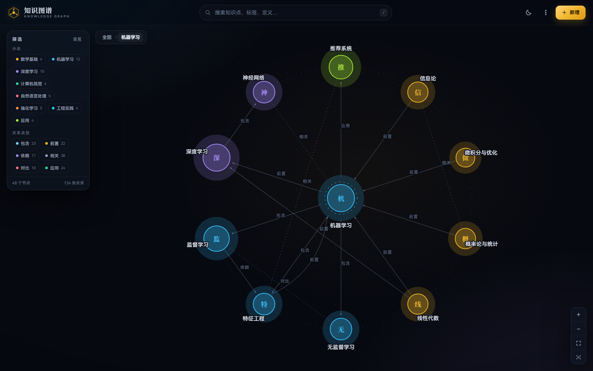
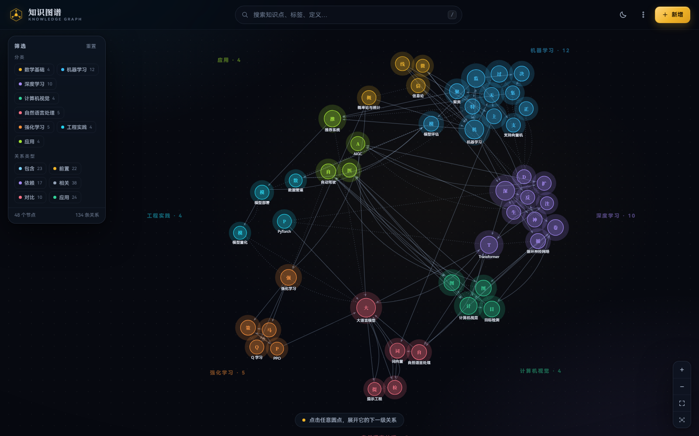
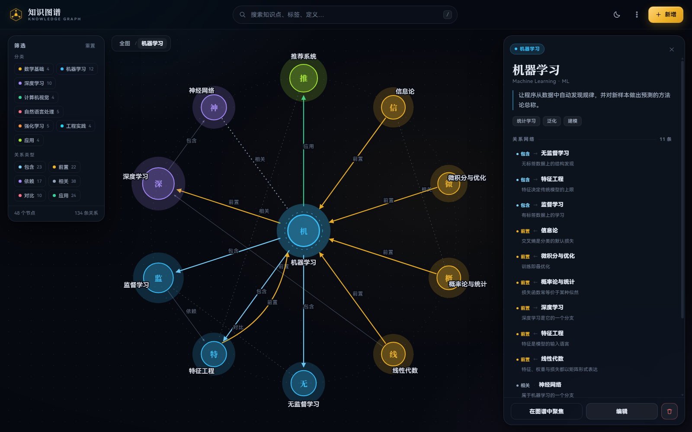
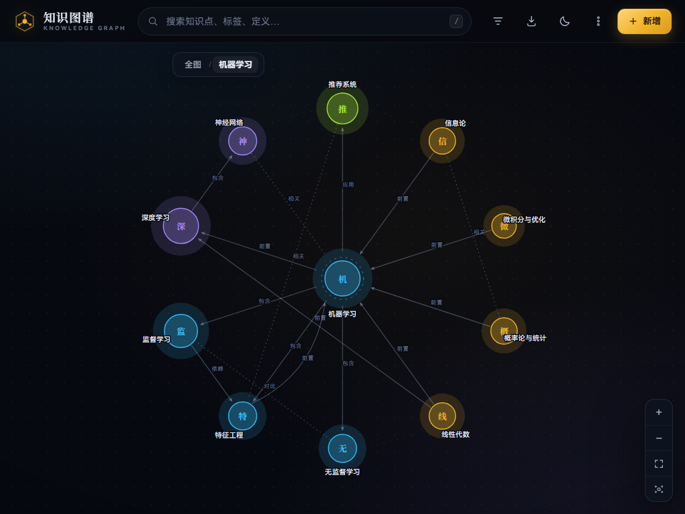
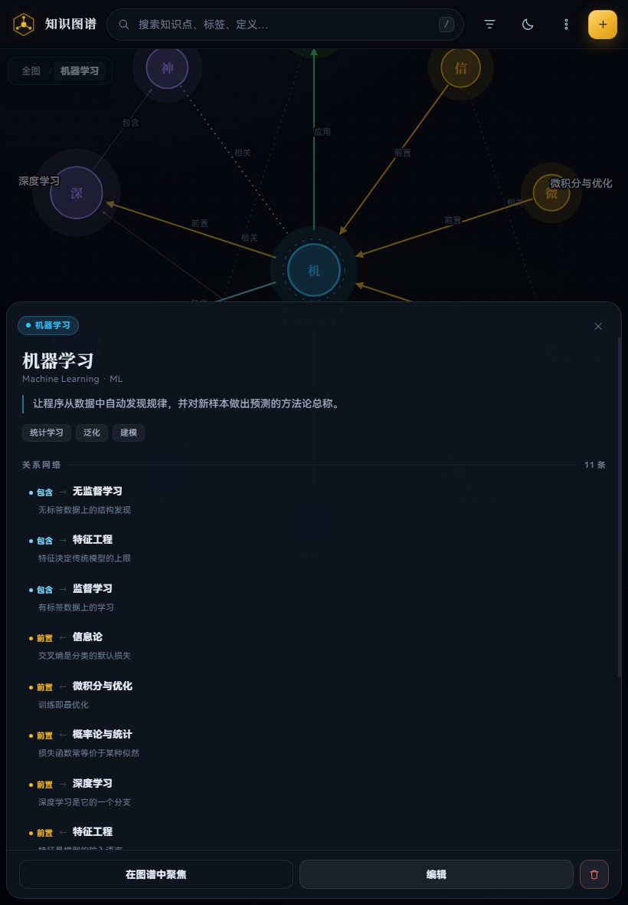

# 知识图谱 · Knowledge Graph

一个**即开即用、零依赖**的本地知识库：把知识点画成一个圆，点开它，下一级关系就像星图一样铺开。
固定字段、可增删改查、模糊搜索、导入导出，桌面 / 平板 / 手机都能用。

> 直接双击 `index.html` 即可打开，无需服务器、无需联网、无需构建。



---

## 1. 怎么用

| 操作 | 说明 |
|---|---|
| 点击圆点 | 以它为中心展开下一级关系（面包屑记录你的下钻路径） |
| 点击邻居圆点 | 继续下钻，进入更深的层级 |
| 点击「全图」 | 回到总览，看所有知识点与分类星团 |
| 搜索 | 顶部搜索框，支持名称 / 别名 / 标签 / 分类 / 定义 / 正文模糊匹配；`/` 聚焦，↑↓ 选择，Enter 打开 |
| 筛选 | 左侧按分类、关系类型过滤，实时影响图谱统计 |
| 缩放 / 平移 | 滚轮缩放（以指针为中心）、拖拽空白平移、拖拽圆点微调位置 |
| 详情面板 | 分类、别名、定义、标签、关系网络、详细说明；可编辑 / 删除 / 定位 |
| 新增 | 右上角「＋ 新增」，填写固定字段并挂接关系 |
| 数据管理 | 右上角「⋮」→ 导出 JSON / 导入 JSON（合并或覆盖）/ 数据格式说明 / 恢复示例 |
| 主题 | 右上角月亮/太阳图标，深色「墨夜」与浅色「宣纸」两套 |
| 平板 / 手机 | 触摸点按、双指缩放、双指平移；详情自动变为底部抽屉；分类筛选收进顶栏漏斗按钮 |

快捷键：`/` 搜索 · `Esc` 关闭弹层 / 取消选中 / 回到全图 · `↑` `↓` `Enter` 搜索结果导航。

---

## 2. 数据是「固定格式」的

每条知识是一条 JSON 记录，字段固定。所有数据保存在浏览器 `localStorage`，可随时导出备份、批量编辑后导入。

### 2.1 知识（node）

| 字段 | 必填 | 类型 | 说明 |
|---|---|---|---|
| `id` | ✅ | string | 唯一标识，导入导出的锚点；新建时自动生成 |
| `name` | ✅ | string | 名称，显示在圆点下方 |
| `category` | ✅ | string | 分类，决定圆点颜色与星团位置；可新建 |
| `aliases` | | string[] | 别名 / 英文名，参与搜索 |
| `tags` | | string[] | 标签，参与搜索 |
| `summary` | | string | 一句话定义，显示在详情与悬停提示 |
| `content` | | string | 详细说明，支持换行 |
| `links` | | object[] | 出边关系数组，见下 |

### 2.2 关系（link）

```json
{ "type": "前置", "to": "transformer", "note": "核心运算" }
```

| 字段 | 必填 | 说明 |
|---|---|---|
| `type` | ✅ | 关系名：`包含` / `前置` / `依赖` / `相关` / `对比` / `应用`（可自定义新类型） |
| `to` | ✅ | 目标知识点的 `id`，必须存在 |
| `note` | | 关系说明，显示在详情面板第二行 |

关系是**有向**的：`A --前置--> B` 表示 A 是 B 的前置。反向关系会自动出现在 B 的详情里（箭头 `←`）。
`相关`、`对比`、`应用` 为无向类型，显示为 `·`。

### 2.3 完整示例

```json
{
  "version": 1,
  "title": "人工智能知识图谱",
  "categories": [
    { "name": "机器学习", "color": "#38BDF8" }
  ],
  "relationTypes": [
    { "name": "包含", "color": "#7DD3FC", "directed": true,  "inverse": "属于" },
    { "name": "前置", "color": "#F0B429", "directed": true,  "inverse": "后续" },
    { "name": "相关", "color": "#94A3B8", "directed": false, "inverse": "相关" }
  ],
  "nodes": [
    {
      "id": "ml",
      "name": "机器学习",
      "aliases": ["Machine Learning", "ML"],
      "category": "机器学习",
      "tags": ["统计学习", "泛化"],
      "summary": "让程序从数据中自动发现规律，并对新样本做出预测的方法论总称。",
      "content": "机器学习的核心问题永远是「泛化」……",
      "links": [
        { "type": "包含", "to": "supervised", "note": "有标签数据上的学习" },
        { "type": "前置", "to": "dl", "note": "深度学习是它的一个分支" }
      ]
    }
  ]
}
```

> 从零开始：在应用里点「⋮ → 恢复示例数据」会载入 `assets/seed.js`；把该文件换成你自己的数据（或导出 JSON 后编辑再导入）即可换成自己的知识库。

---

## 3. 增删改查

- **增**：右上角「＋ 新增」→ 填名称 / 分类 / 别名 / 标签 / 定义 / 说明 → 「＋ 添加关系」挂接目标与关系类型 → 保存。
- **改**：打开任意知识点，底部「编辑」；分类可直接输入新名字，保存后自动出现在筛选与图例里。
- **删**：详情底部删除按钮，会提示将同时删除多少条指向它的关系。
- **查**：搜索框模糊匹配 + 分类/关系类型筛选；搜索结果会同步让图上命中的圆点呼吸发光。

数据自动保存在本机浏览器。换设备 / 换浏览器时，用「导出 JSON」→「导入 JSON」迁移；导入支持**合并**（同 id 更新，其余新增）与**覆盖**两种方式。

---

## 4. 平板与手机

**怎么在平板上打开**：PC 与平板连同一个 WiFi → 双击项目里的 `serve.cmd`（或 `node serve.js`）→ 控制台会打印形如 `http://10.89.79.248:8777/` 的地址 → 平板浏览器打开即可。iOS 可用「分享 → 添加到主屏幕」全屏使用；不要直接双击 index.html 再传到平板（部分浏览器会限制 file:// 下的本地存储）。

- 布局：≥1180px 显示左侧筛选栏；≤1180px 收进顶栏漏斗按钮；≤900px 详情面板变为底部抽屉；≤640px 顶栏进一步压缩。
- 触摸：单指拖拽平移、双指捏合缩放、点按选中；`touch-action: none` 防止页面被手势滚动打断。
- 触摸已实测（1024×768 / 820×1180）：单指点按选中并下钻、双指捏合缩放、单指拖拽平移；详情在 ≥900px 为右侧面板，<900px 自动变为底部抽屉。
- 动画：切换焦点时圆点按 easeOutBack 缓动滑向新位置（约 520ms、4% 回弹），半径同步放大/缩小，连线淡入淡出；`?static=1` 可关闭全部动画。

### 装到设备（PWA / 离线）

项目已带 `manifest.webmanifest`、`sw.js` 和整套图标（192 / 512 / maskable / Apple 180），部署到 HTTPS 地址后就是一个可安装的应用：

- **iOS Safari**：分享 → 添加到主屏幕（没有安装按钮，苹果不支持自动安装）
- **Android Chrome**：右上角 ⋮ → 安装应用（或点页面上的下载图标）
- **Windows / macOS**：Chrome / Edge 地址栏右侧的安装图标，或「⋮ → 安装到设备」
- 装好后独立窗口、无地址栏，断网可开，数据仍在本机。

> ⚠️ 只有 **HTTPS 或 localhost** 才会启用 Service Worker 和安装提示。用 `serve.cmd` 走 `http://192.168.x.x` 时只能当普通网页用（能看能用，但不离线、不可安装）——所以“装上”这件事需要 GitHub Pages / Netlify 这类 HTTPS 地址。

> 直接把文件夹拷到平板、用浏览器打开 `index.html` 也能看，但多数浏览器会禁止 `file://` 页面写入 localStorage，改动不会保存（应用检测到会弹提示）。要真正在平板上用，建议下面的 GitHub Pages 方式。
- 提供 `?static=1`（关闭全部动画，适合低性能平板或截图）与 `?theme=light|dark`、`?view=overview`、`#知识点id` 深链参数。

---

### 性能

- **全图布局缓存**：分类星团的松弛计算只在启动/数据变更时做一次；从任意深度返回全图直接复用缓存坐标，不再重算。
- **滑动 + 分步浮现**：返回全图时，离开过位置的点**逐个滑回**（每个迟 9ms，easeOutBack 轻微回弹），镜头同时在 620ms 内拉回全图；每个点带着自己的连线一起淡入，分类名在过程中段出现——不会出现“线先出来、指向空白”。
- **修复镜头竞态**：关闭详情面板的入场动画以前会在返回后继续跑，把镜头又拉回焦点处；现在新的视图动画会取消旧的。
- **没有常驻动画**：去掉了选中节点虚线环的无限旋转，提示条淡出后停止呼吸动画——否则整个 SVG 会一直重绘，平板待机都发热。
- **空闲零重绘**：没有动画/拖拽时不写 DOM；标签碰撞检测改为“视图静止后”再算一次，不再每 7 帧跑 O(n²)。
- **触屏降级**：触摸设备自动去掉毛玻璃 `backdrop-filter`、缩小阴影与光晕。
- 实测（4× CPU 降频模拟平板）：从深层返回全图的动画帧率约 **17 → 55+ fps**，静止时 60 fps。
- **`?debug=1`**：左下角显示实时 FPS，方便在真机上定位卡顿。
- **流畅模式**：右上角「⋮ → 流畅模式」，一键关掉动画/光晕/模糊，位置瞬时切换（设置会记住）。
- 仍嫌慢可加 `?static=1` 关闭动画，或系统开启「减少动态效果」（会自动识别）。

> 说明：全部资源（HTML/CSS/JS/示例数据）合计约 110KB，加载后由浏览器缓存，交互过程**不发任何网络请求**；带宽不是瓶颈，卡顿只可能来自设备端渲染。

## 5. 文件结构

```text
knowledge_graph/
├─ index.html            # 页面骨架（SVG 图层 + 面板 + 弹层）
├─ manifest.webmanifest  # PWA 清单（名称/图标/独立窗口）
├─ sw.js                 # Service Worker（离线缓存，网络优先）
├─ serve.cmd / serve.js  # 局域网静态服务器（平板访问用）
├─ assets/
│  ├─ styles.css         # 双主题、响应式、图元样式
│  ├─ app.js             # 布局 / 渲染 / 交互 / 增删改查 / 导入导出
│  ├─ seed.js            # 示例数据（48 个知识点 / 134 条关系，可直接替换）
│  └─ icon-*.png         # 应用图标（192/512/maskable/apple/favicon）
├─ .github/workflows/    # Pages 自动部署
├─ dist/                 # 部署 zip（拖给 Netlify / Cloudflare）
├─ docs/                 # 截图
└─ README.md
```

技术要点：

- 纯原生 JS（ES5 语法）+ SVG，无任何依赖、无构建步骤，`file://` 下可运行。
- 总览采用「分类星团 + 碰撞松弛」布局：分类围绕圆心分布，节点在簇内松弛、互不重叠。
- 下钻采用径向布局：中心节点放大，一级邻居环绕成环，关系标签沿边显示。
- 标签做了碰撞避让：空间不足时优先隐藏低度数节点的文字，悬停/选中仍会显示。

## 6. 截图

| 总览 | 详情 |
|---|---|
|  |  |

| 平板横屏 | 平板竖屏 |
|---|---|
|  |  |


---

## 7. 部署

应用是纯静态的：把 `index.html`、`assets/`、`manifest.webmanifest`、`sw.js` 放到任意静态托管即可，不需要 Node、不需要构建。

### 方式 A：GitHub Pages（网页上传，不用装 git）

1. GitHub 新建仓库，选 **Public**；
2. 仓库页 → **Add file → Upload files**，把 `index.html`、`manifest.webmanifest`、`sw.js` 和整个 `assets` 文件夹拖进去，Commit；
3. **Settings → Pages → Build and deployment**：Source 选 `Deploy from a branch`，Branch 选 `main` + `/(root)`，Save；
4. 等 1–2 分钟，访问 `https://<用户名>.github.io/<仓库名>/`；
5. 平板打开一次 → 分享 → 添加到主屏幕。

### 方式 B：git push（可选）

仓库已附 `.github/workflows/deploy.yml`：把 `Settings → Pages → Source` 改成 **GitHub Actions**，之后每次 push 到 `main` 自动部署。

```bash
git init && git add . && git commit -m "init"
git branch -M main
git remote add origin https://github.com/<用户名>/<仓库>.git
git push -u origin main
```

### 国内访问不稳怎么办

先说结论：**装到主屏之后就不依赖网络了**。Service Worker 会把全部资源缓存到本地，断网也能打开；只有“发布新版本后第一次打开”需要连一次网。

如果 `*.github.io` 打不开或很慢，可以换托管（都是拖文件即部署）：

| 方案 | 优点 | 代价 |
|---|---|---|
| **Netlify Drop**（app.netlify.com/drop） | 把 `dist/knowledge_graph.zip` 直接拖进去，几秒出 HTTPS 地址，不用账号也能试 | 国内速度一般 |
| **Cloudflare Pages** | 免费、全球 CDN，可绑自定义域名 | 国内速度一般 |
| **腾讯云 EdgeOne Pages / COS 静态托管** | 国内快 | 需实名，自定义域名需备案 |
| **局域网 `serve.cmd`** | 零延迟、最稳，完全不碰外网 | 只能同一 WiFi |

`dist/knowledge_graph.zip` 已经打好（约 47KB），专门给 Netlify / Cloudflare 这类“拖拽上传”的托管用。

> 提醒：GitHub Public 仓库的页面和示例数据对所有人可见；知识内容涉密就不要用公开仓库，改用局域网或私有部署。


---

## 8. 云同步（用 GitHub 仓库当数据库）

数据文件是仓库根目录的 `data.json`。应用通过 GitHub API 读写它，所有设备共用一份数据。

### 开启步骤（每台设备一次）

1. 打开应用 → 右上角 `⋮` → **云同步**；
2. 填：所有者 `caiasas`、仓库 `knowledge-graph`、分支 `main`、文件 `data.json`；
3. 粘贴一个 **Fine-grained token**（写入必需）：
   - GitHub → Settings → Developer settings → **Fine-grained tokens** → Generate new token
   - Repository access：**Only select repositories** → 选 `knowledge-graph`
   - Permissions → Repository permissions → **Contents: Read and write**
   - 生成后复制 `github_pat_...`
4. 点「保存并同步」。状态点在顶栏：绿=正常、黄=同步中、红=失败、灰=只读。

### 行为

- 每次修改后 **1.2 秒**自动推送到仓库；
- 有 Token 的设备每 **20 秒**拉一次；没 Token 的设备只读（5 分钟拉一次，避免触发未认证限流）；
- 冲突策略：**最后写入者赢**，写入前基于文件 sha 校验，被抢先修改会自动重取再写；
- Token 只存在本机浏览器的 localStorage，不会写进仓库。

> 注意：仓库是 Public 时，`data.json` 里的知识内容对所有人可见。需要私密内容就把仓库设为 Private，但免费账号的 Pages 不支持私有仓库（需 GitHub Pro）。


---

## 9. 安卓平板当服务器（Termux）

不用电脑、不用外网，平板自己跑服务、自己用；同一 WiFi 下其他设备也能访问。

1. 平板装 **Termux**（建议从 F-Droid 或 GitHub 安装，应用商店版本过旧）；
2. 把整个项目文件夹拷到平板（数据线 / 网盘都行），例如 `/sdcard/Download/knowledge_graph`；
   也可以直接在 Termux 里 `pkg install git && git clone https://github.com/caiasas/knowledge-graph.git`；
3. 进目录运行：
   ```bash
   bash termux-setup.sh
   ```
   首次会自动装 Node.js 并申请存储权限，然后打印两个地址；
4. Chrome 打开 `http://localhost:8777/`（localhost 属于安全上下文，**可以安装 PWA、可以离线**）→ 菜单「安装应用」；
5. 装好之后，即使 Termux 停了、平板重启，主屏图标也能靠 Service Worker 缓存离线打开；要更新时再跑一次脚本。

> 平板作为服务器时，数据存在平板的 Chrome 里；想让电脑也看到同一份数据，两种办法：让电脑访问 `http://<平板IP>:8777/`（数据仍在平板浏览器里，不共享），或者继续用「云同步」写回 GitHub 私有仓库。
